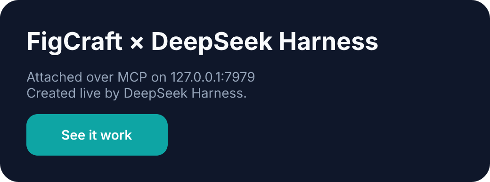

# FigCraft for DeepSeek Harness

A [DeepSeek Harness](https://github.com/deepseek-ai/deepseek-harness) (DSH)
bundle that connects the [FigCraft](https://getartcraft.com/apps/figcraft)
desktop app to your agent over MCP.



FigCraft serves MCP over stdio in attach mode. The agent gets FigCraft's tools
under `mcp__figcraft__*`: create and edit layers, run menu commands, inspect the
open document, take screenshots, and read or reply to comments. Attach mode
means the agent works in the document you already have open, and you watch the
changes happen.

## On-demand by design

FigCraft exposes its control port only when it starts with `--control PORT`.
Starting it with the desktop shortcut skips that flag, so the bundle ships a
launcher that starts the app correctly and stops it again. Nothing starts at
login, and nothing stays loaded after `figoff`.

```text
figon [file]   start FigCraft, optionally opening a .figcraft file
figoff         quit FigCraft
figstat        show app, control port and CLI state
figcli ...     run figcraft-cli itself (info, export, render, run, ...)
```

Start FigCraft before DSH:

```bash
figon ~/Designs/MyApp.figcraft
# then launch DeepSeek Harness
```

If DSH is already running when you start FigCraft, restart DSH or open a new
session. The MCP client retries a closed server until its attempt budget runs
out, then removes the tools; a fresh session connects on the first try.

## Platform support

| Platform | App package | CLI comes from | Launcher |
| --- | --- | --- | --- |
| macOS 11+ | Homebrew cask or DMG | `figcraft-cli-*-macos-universal.zip` | launchd job |
| Ubuntu / Debian | `.deb` | `/usr/bin/figcraft-cli` | detached process |
| Fedora / RHEL | `.rpm` | `/usr/bin/figcraft-cli` | detached process |
| Arch Linux | `.pkg.tar.zst` | `/usr/bin/figcraft-cli` | detached process |
| Windows 10+ | MSI or portable ZIP | `figcraft-cli.exe` next to `figcraft.exe` | PowerShell |
| Linux AppImage | `.AppImage` | `FigCraft.AppImage cli` | detached process |
| Linux Flatpak | `.flatpak` | `flatpak run --command=figcraft-cli` | detached process |

Linux packages need glibc 2.35 or later, which covers Ubuntu 22.04+, Fedora 36+
and current Arch. The official Linux binaries are built on Ubuntu 22.04.

## Install

Commands below use version `0.18.1`. Substitute the current release if it is
newer. The DSH bundle is the same on every platform.

### macOS

```bash
brew install --cask figcraft
git clone https://github.com/madsouris/dsh-figcraft.git
cd dsh-figcraft
./scripts/install.sh --with-cli
```

### Ubuntu and Debian

Install the app and its CLI from the release `.deb`:

```bash
curl -LO https://github.com/storytold/figcraft/releases/download/v0.18.1/figcraft-0.18.1-linux-x86_64.deb
sudo apt install ./figcraft-0.18.1-linux-x86_64.deb
git clone https://github.com/madsouris/dsh-figcraft.git
cd dsh-figcraft
./scripts/install.sh
```

Use `linux-aarch64.deb` on arm64.

### Fedora and RHEL

```bash
curl -LO https://github.com/storytold/figcraft/releases/download/v0.18.1/figcraft-0.18.1-linux-x86_64.rpm
sudo dnf install ./figcraft-0.18.1-linux-x86_64.rpm
git clone https://github.com/madsouris/dsh-figcraft.git
cd dsh-figcraft
./scripts/install.sh
```

Use `linux-aarch64.rpm` on arm64. RHEL 9 ships glibc 2.34, which the RPM
refuses; use RHEL 10+ or build FigCraft from source.

### Arch Linux

```bash
curl -LO https://github.com/storytold/figcraft/releases/download/v0.18.1/figcraft-0.18.1-linux-x86_64.pkg.tar.zst
sudo pacman -U figcraft-0.18.1-linux-x86_64.pkg.tar.zst
git clone https://github.com/madsouris/dsh-figcraft.git
cd dsh-figcraft
./scripts/install.sh
```

The release package installs `/usr/bin/figcraft` and `/usr/bin/figcraft-cli`.
Use the `linux-aarch64` package on arm64.

### Windows

Install the MSI, or extract the portable ZIP from the
[release](https://github.com/storytold/figcraft/releases/latest). Both contain
`figcraft.exe` and `figcraft-cli.exe`.

```powershell
git clone https://github.com/madsouris/dsh-figcraft.git
cd dsh-figcraft
powershell -ExecutionPolicy Bypass -File .\scripts\install.ps1
```

For the portable ZIP, point the installer at the extracted folder:

```powershell
powershell -ExecutionPolicy Bypass -File .\scripts\install.ps1 -AppDir "C:\Users\me\Apps\figcraft-0.18.1-windows-x64-portable"
```

The installer copies `figon.cmd`, `figoff.cmd`, `figstat.cmd` and `figcli.cmd`
into `%USERPROFILE%\.local\bin`, then adds that folder and the FigCraft folder
to your user `PATH`. The FigCraft folder must be on `PATH` because the bundle's
Windows row starts `figcraft-cli.exe` directly. Open a new terminal after the
install, and restart DSH if it was already running.

### Linux AppImage

```bash
chmod +x FigCraft.AppImage
./scripts/install.sh --app /absolute/path/to/FigCraft.AppImage
```

The installer writes the app path to `~/.config/dsh-figcraft/config`. The MCP
wrapper then runs `FigCraft.AppImage cli mcp --attach 7979`.

### Linux Flatpak

Install the release `.flatpak`, then run the normal installer:

```bash
./scripts/install.sh
figon
```

The launcher detects `ai.storyteller.figcraft` and starts it with
`flatpak run`. File access follows the Flatpak sandbox, so grant the folders
FigCraft should read and write.

### Add the aliases

On macOS and Linux, add the aliases to zsh or bash:

```bash
echo 'source ~/.config/dsh-figcraft/aliases.sh' >> ~/.zshrc
# or: echo 'source ~/.config/dsh-figcraft/aliases.sh' >> ~/.bashrc
```

On Windows the `.cmd` shims are already on `PATH`; `figon` works in PowerShell
and in `cmd.exe`.

### Install the bundle in DSH

In a session:

```text
plugin_manager install_bundle target=/absolute/path/to/dsh-figcraft
```

Or open **Plugins** and add the cloned directory. Restart DSH if the tools do
not appear.

The package is named `@local/dsh-figcraft` and marked `private`, so installing
from the directory links it into your profile and it cannot be pushed to npm by
accident.

## How it works

The bundle patch inserts two `@deepseek-ai/dsh-mcp-client` rows. DSH evaluates
each row's `disabled` expression against its own `process`, so macOS and Linux
mount the `/bin/sh` row and Windows mounts the `figcraft-cli.exe` row. Only one
row reserves the `figcraft` server name.

On macOS and Linux the row runs `figcraft-mcp`, which finds the CLI and replaces
itself with:

```text
figcraft-cli mcp --attach 7979
```

On Windows the row runs `figcraft-cli.exe mcp --attach 7979` directly; the
installer puts the FigCraft folder on `PATH`.

The launcher differs by platform:

- **macOS** writes
  `~/Library/Application Support/dsh-figcraft/local.dsh.figcraft.control.plist`,
  loads it with `launchctl bootstrap`, and unloads it on `figoff`. Starting
  through launchd also prevents FigCraft from inheriting a sandboxed shell, so
  saving files works.
- **Linux** starts `figcraft --control 7979` detached with `setsid`, writes its
  pid to `~/.local/state/dsh-figcraft/app.pid`, and sends `SIGTERM` on
  `figoff`. Run `figon` from your desktop terminal, not from an agent's
  sandboxed shell.
- **Windows** starts `figcraft.exe --control 7979` with `Start-Process`, writes
  the pid to `%LOCALAPPDATA%\dsh-figcraft\app.pid`, and closes the main window
  on `figoff`.

`figon file` opens the file through the app's control protocol after the port
is ready. The control server binds to `127.0.0.1` only.

Logs:

| Platform | Log |
| --- | --- |
| macOS | `~/Library/Logs/dsh-figcraft/control.log` |
| Linux | `~/.local/state/dsh-figcraft/control.log` |
| Windows | `%LOCALAPPDATA%\dsh-figcraft\control.out.log` and `control.err.log` |

## Configuration

| Variable | Used by | Meaning |
| --- | --- | --- |
| `FIGCRAFT_APP` | launcher and installer | App bundle, AppImage, or `figcraft` executable |
| `FIGCRAFT_CLI` | launcher and MCP wrapper | `figcraft-cli` executable |

The installer writes both when you pass `--app` or `--cli`:

- macOS and Linux: `~/.config/dsh-figcraft/config`
- Windows: `%APPDATA%\dsh-figcraft\config.ps1`

Use the installer flags or edit that file. DSH starts the MCP process with a
short environment whitelist (`HOME`, `PATH` and a few others), so a
`FIGCRAFT_CLI` exported only in your shell reaches `figon` but not
`figcraft-mcp`. The config file is read by both.

On Windows the MCP row calls `figcraft-cli.exe` from `PATH`, so the FigCraft
folder has to be on `PATH`. `install.ps1` adds it.

Without those variables the scripts search the normal package locations:

- macOS: `~/.local/bin`, Homebrew prefixes, `/usr/local/bin`, then `PATH`
- Linux: `/usr/bin`, `/usr/local/bin`, `~/.local/bin`, then `PATH`
- Windows: the FigCraft folder from the installer or registry, then `PATH`

The control port is fixed at `7979` in `bin/figcraft-session-*`,
`bin/figcraft-mcp`, `bin/figcraft-session.ps1` and `cordis.patch.yml`. Change
all of them if you need a different port.

## Updating

Update the app and CLI together. They ship from the same release and have no
version handshake.

- macOS: `brew upgrade --cask figcraft`, then
  `./scripts/install.sh --with-cli --version <new-version>`.
- Ubuntu, Fedora, Arch: install the new package, then run
  `./scripts/install.sh` again.
- Windows: install the new MSI or portable ZIP, then run
  `scripts\install.ps1` again with the same `-AppDir` if you used one.

Then restart FigCraft:

```bash
figoff
figon
```

## Troubleshooting

`figstat` says **running WITHOUT the control port**. FigCraft was started from
the desktop shortcut or the app menu. Save your work, quit it, then run `figon`.

DSH shows no `mcp__figcraft__*` tools. Run `figstat` first. If FigCraft is
running with the port open, restart DSH or open a new session. On Windows,
restart DSH after `install.ps1` changes `PATH`.

`figon` is not recognized on Windows. Open a new terminal after the installer,
or check that `%USERPROFILE%\.local\bin` is on `PATH`. If DSH still cannot find
`figcraft-cli.exe`, sign out and back in so Windows rebuilds the user
environment, or add the FigCraft folder to `PATH` by hand.

`figcraft-cli.exe` is missing. The MSI and portable ZIP from 0.18.1 or later
include it. Point the installer at the right folder with `-AppDir`.

`figcraft-cli not found` on Linux. The distro packages include the CLI. If you
extracted a tarball, run the installer with `--cli /path/to/figcraft-cli`.

Saving fails with `Operation not permitted` on macOS or Linux. FigCraft was
started inside a sandboxed shell. Quit it and run `figon` from your normal
terminal.

The control port never opens. Read the log for your platform. Another process
may already hold 7979:

```bash
lsof -nP -iTCP:7979 -sTCP:LISTEN        # macOS and Linux
netstat -ano | findstr :7979            # Windows
```

## Uninstall

```bash
figoff
```

Remove the bundle from **Plugins** in DSH, then delete the launcher files.

macOS and Linux:

```bash
rm -f ~/.local/bin/figcraft-mcp ~/.local/bin/figcraft-session
rm -f ~/.local/bin/figcraft-session-macos ~/.local/bin/figcraft-session-linux
rm -f ~/.local/bin/figcraft-cli
rm -rf ~/.local/share/figcraft-cli ~/.config/dsh-figcraft
rm -rf ~/.local/state/dsh-figcraft
rm -rf ~/Library/Application\ Support/dsh-figcraft ~/Library/Logs/dsh-figcraft
```

Windows:

```powershell
Remove-Item "$env:USERPROFILE\.local\bin\figcraft-*" -Force
Remove-Item "$env:USERPROFILE\.local\bin\fig*.cmd" -Force
Remove-Item "$env:LOCALAPPDATA\dsh-figcraft" -Recurse -Force
```

Then remove FigCraft itself with your package manager or Windows Settings.

## Repository layout

```text
bin/figcraft-mcp              POSIX MCP wrapper (macOS and Linux)
bin/figcraft-session          macOS/Linux launcher dispatcher
bin/figcraft-session-macos    launchd launcher
bin/figcraft-session-linux    detached process launcher
bin/figcraft-session.ps1      Windows launcher
bin/figon.cmd                 Windows shim, also figoff/figstat/figcli
cordis.patch.yml              DSH bundle patch
scripts/install.sh            macOS and Linux installer
scripts/install.ps1           Windows installer
shell/figcraft.sh             POSIX shell aliases
locale/en.json                plugin title and description
docs/preview.png              preview image
```

## License

MIT. FigCraft is a separate project by the ArtCraft Team; this bundle ships an
original icon and no FigCraft binaries, and it is not affiliated with the
FigCraft project.
